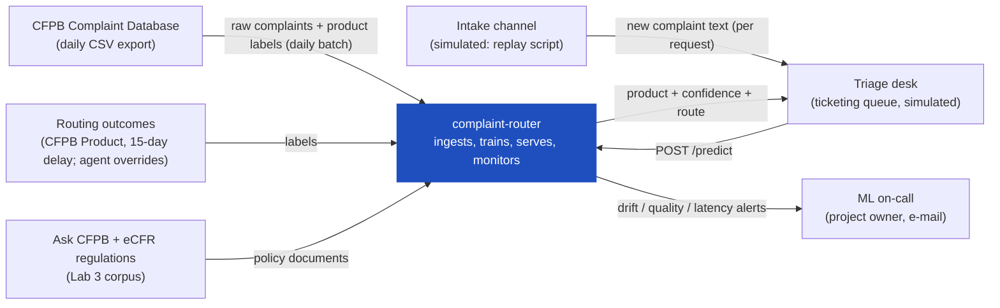
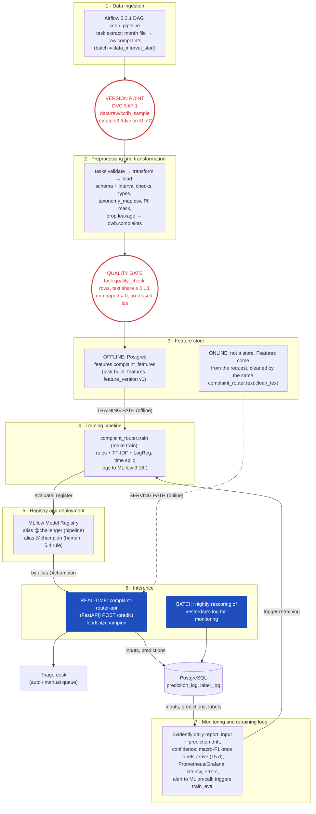
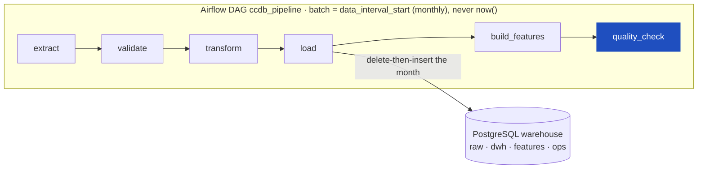
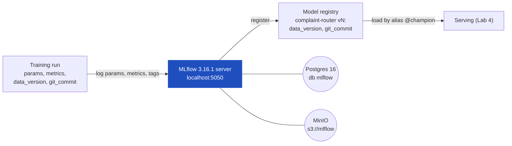
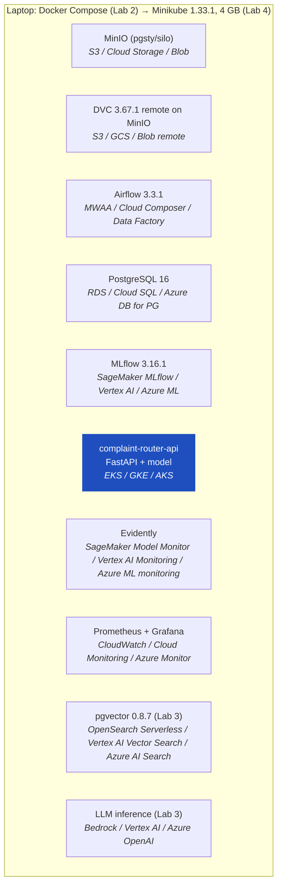

# Design document: complaint-router

Routing consumer financial complaints to the right product queue, with a system that keeps learning.

| | |
|---|---|
| Author | Zakhar Staryk |
| Status | Lab 1 draft (design only, no pipeline yet) |
| Last revised | 2026-10-17 (data profiled; source switched to a text snapshot, see 5.2) |
| Later revisions | Lab 2: 5.2, 5.4, 6.1, 7.2 · Lab 3: 5.3, 6.2, 6.7 · Lab 4: 6.1 (deployment), 6.3, 6.6, 7.3 · Lab 5: 6.8, 7.4 |

Statements marked **Assumption:** are decisions taken without evidence yet. Each one names the lab that will confirm or replace it. Statements marked **Measured:** come from `scripts/profile_data.py`; the full numbers are in [`docs/data-profile.md`](data-profile.md).

---

## 1 Overview

A complaint intake desk gets fifteen to twenty thousand free-text consumer complaints a day about financial products (mortgages, credit cards, credit reports, debt collection and more). Each one has to reach the team that owns that product, and a complaint that lands in the wrong queue waits days before someone reroutes it. complaint-router reads the complaint text when it arrives and predicts the product queue with a confidence score. Complaints it is confident about are routed automatically; the rest go to a human triage queue with the prediction as a suggestion. The goal is fewer misrouted complaints and less manual triage, from a model that is retrained as the product mix and complaint vocabulary change.

## 2 Motivation

**Who consumes the predictions.** The intake desk's ticketing queue (the *Triage desk* in the diagrams) calls the service once per new complaint and uses the answer to set the ticket's queue. Triage agents see the prediction and its confidence on every complaint that is not auto-routed.

**How often.** Continuously during intake hours, one request per complaint. **Measured:** the CFPB database received 5.4 million complaints in 2025 (about 15,000 a day) and 620,000–690,000 a month from March to September 2026 (about 21,000 a day). **Assumption:** intake runs 12 hours a day and the busiest minute is 5× the average rate.

**What happens when they are wrong.** A misrouted complaint goes to a team that does not own it. That team has to notice, reassign it, and the clock on the regulatory response window (15 days for a first response under CFPB's process) keeps running. Systematic errors hurt more than random ones. If the model starts sending, say, new "buy now, pay later" complaints to the credit-card team, a whole category gets slow and nobody notices until labels come back.

**Why a system and not a notebook.** Three things change over time and a notebook cannot follow them:

- **The label space.** **Measured:** CFPB changed its product taxonomy twice, in April 2017 and in August 2023, and every change renamed or merged products (20 distinct product names map onto our 10 classes). A new class, *Debt or credit management*, appeared in August 2023. New products appear as complaints before they have their own category.
- **The class mix.** **Measured:** credit reporting was 19% of narratives in 2016, 69% in 2022 and 77% in 2024, while yearly volume grew from 0.19 million (2016) to 5.4 million (2025). A model trained on old data has the wrong priors.
- **The vocabulary.** New scams, new company names, new regulations.

The system therefore needs scheduled ingestion, versioned data, tracked retraining, a promotion rule and monitoring that works before labels arrive. Those are what Labs 2 to 5 build.

## 3 Success metrics

Three layers, kept apart. Each target is either backed by a number or marked as an assumption.

| Layer | Metric | Target | Type | Status |
|---|---|---|---|---|
| Business | **Misrouting rate**: share of complaints whose queue is changed by a human after routing | ≤ 8% (from an assumed 15% with manual keyword triage) | Optimizing (business) | **Assumption:** there is no real desk to measure. In this project it is emulated as the share of predictions that disagree with the delayed label (section 5.2). |
| Business | **Auto-route coverage**: share of complaints routed with no human touch | ≥ 60% | Satisficing | **Assumption**, derived from the confidence threshold in 5.4. |
| Model | **Macro-F1** over the product classes on the most recent held-out month | ≥ 0.80, and ≥ baseline + 0.10 | Optimizing (model) | Assumption until the Lab 2 baseline sets the real reference point. |
| Model | **Precision on the auto-routed slice** (confidence ≥ threshold) | ≥ 0.95 | Satisficing | Sets the threshold. The threshold then determines coverage. |
| System | **p95 latency** of `POST /predict`, measured at the service | ≤ 300 ms | Satisficing | **Assumption:** no consumer SLA exists yet, so 300 ms was picked so routing feels instant to a triage agent. |
| System | **Availability** during intake hours (08:00–20:00 local) | ≥ 99.5% monthly | Satisficing | Assumption. The fallback in section 4 keeps intake working when the service is down. |
| System | **Data freshness**: age of the newest ingested complaint | ≤ 3 days | Satisficing | The CFPB export is refreshed daily (observed 2026-10-12: `last-modified` that same day). |

The optimizing metric for model selection is macro-F1, chosen over accuracy because the classes are heavily imbalanced. Every other row is a constraint that a candidate model must meet before macro-F1 is compared.

## 4 Requirements and constraints

### Functional requirements

| # | Requirement |
|---|---|
| F1 | **Input.** `POST /predict` with JSON `{complaint_id, narrative, date_received, submitted_via, state, company}`. Only `complaint_id` and `narrative` are required. |
| F2 | **Output.** `{complaint_id, product, confidence, top3: [{product, p}], route: "auto" \| "manual", model_version}`. |
| F3 | **Caller.** Only the Triage desk (the ticketing integration) calls the service, using an API key. There are no end-user calls. |
| F4 | `route = "auto"` iff `confidence ≥ threshold`. The threshold is stored with the model version in the registry, not in code. |
| F5 | Every request and response is logged (text hashed, see 6.5) with `model_version`, so that a prediction can be joined to its label later. |
| F6 | A scheduled pipeline ingests each new CFPB batch, validates it, versions it and makes it available for training. |
| F7 | A retraining run can be triggered on a schedule (monthly) or by a drift alert. It produces a registered candidate, which is never auto-promoted. |
| F8 | `GET /health` reports liveness, plus readiness with the loaded `model_version`. Readiness fails if no model is loaded. |

### Non-functional requirements

One row per category, each with a number or an explicit assumption.

| Category | Requirement |
|---|---|
| Freshness | The structured CFPB export is ingested daily and is ≤ 3 days old when used; text batches are replayed one month per run from the text snapshot (5.2). Labels are joined to predictions 15 days after prediction (emulated delay, 5.2). The serving model is trained on data no older than 35 days at promotion time. |
| Latency and throughput | p95 ≤ 300 ms and p99 ≤ 800 ms for `POST /predict` with narratives up to 10,000 characters. Sustains 20 req/s on one CPU replica, against a peak need of about 2.5 req/s (21,000 a day over 12 intake hours, ×5 at peak). |
| Availability and fallback | ≥ 99.5% during intake hours. **Fallback:** if the service errors or exceeds 2 s, the Triage desk sends the complaint to the manual queue, so routing is never blocked. If the model fails to load, readiness fails and the previous `@champion` version keeps serving. |
| Reproducibility | Any registered model can be rebuilt from `(git commit, DVC data version, params)` with one command, and these three are logged on every MLflow run. Environment pinned by `uv.lock`; container images tagged with the commit (Lab 4). |
| Adaptability | Monthly scheduled retraining, plus retraining triggered by drift alerts. Unknown product labels in a new batch are mapped through a versioned taxonomy table. An unmapped label fails the quality gate instead of silently becoming a new class. |
| Observability without ground truth | For the 15 days before labels arrive, the system monitors input drift (text length, OOV-token rate, `submitted_via` mix), prediction drift (class distribution PSI against the reference month) and confidence drift (mean max-probability, share routed `auto`). Thresholds are in 6.6. Accuracy is measured only once labels arrive. |
| Cost and resource ceilings | Local: the whole stack fits in Minikube with 4 GB RAM and 2 CPUs. The model is ≤ 200 MB on disk and ≤ 1 GB RAM per replica, and training takes ≤ 30 min on a laptop CPU. Cloud equivalent ≤ $800/month (estimate in 6.7). |

**Conflict between requirements.** Freshness and reproducibility pull against each other. Training on the newest data means training on batches that were ingested hours ago, before the same-day re-export from CFPB has settled (CFPB re-publishes and amends rows). Reproducibility wins: training reads only DVC-tagged snapshots, which costs up to one day of freshness. That is why the freshness row says ≤ 3 days and not "same day".

### In scope

- Product-level routing (one label per complaint) from the narrative plus intake-form fields.
- Batch ingestion of the public CFPB export, data versioning, quality gate, training, registry, online serving, monitoring and drift alerts.
- An LLM component (Lab 3): a zero-shot LLM classifier evaluated as a baseline against the trained model, and a retrieval-backed rationale for triage agents that cites Ask CFPB and regulation passages.
- An agent (Lab 5) that can run the operational playbook: check drift, compare candidate with champion, draft a promotion note.

### Out of scope

- Issue and sub-issue level routing (rejected in 5.1, possibly later).
- Real integration with a ticketing product. The Triage desk is simulated by a replay script.
- Drafting replies to consumers, and any decision on the merit of a complaint.
- Languages other than English, and complaints without a narrative (they go straight to manual triage).
- Production cloud deployment. Cloud services are named and costed but not run.

## 5 Methodology

### 5.1 Problem statement

**Framing:** single-label multiclass text classification. The input is the complaint narrative (plus optional form fields), and the output is one of ten consolidated product classes (share of training-window narratives, **measured**):

| # | Class | Share |
|---|---|---|
| 1 | Credit reporting | 74.2% |
| 2 | Debt collection | 7.7% |
| 3 | Credit or prepaid card | 5.0% |
| 4 | Checking or savings | 4.4% |
| 5 | Money transfer and virtual currency | 4.2% |
| 6 | Mortgage | 1.6% |
| 7 | Student loan | 1.1% |
| 8 | Vehicle loan or lease | 1.0% |
| 9 | Payday, title and personal loan | 0.6% |
| 10 | Debt or credit management | 0.2% |

"Consolidated" means the 20 product names CFPB used across its 2012, 2017 and 2023 taxonomies are mapped onto one stable set by the versioned table [`configs/taxonomy_map.csv`](../configs/taxonomy_map.csv). Credit card and prepaid card are one class because CFPB merged them from 2017 to 2023. 1,333 rows (0.008%) carry a product outside the map (`Other`, blank) and go to manual triage.

**Rejected framing: issue-level routing.** CFPB's `Issue` field has many dozens of values, several of them shared across products and renamed between taxonomy versions. A flat classifier would be sparse in most classes and invalidated by every taxonomy change, and a hierarchical one doubles the evaluation surface before the simple system works. Product is what decides the owning team, so it is the decision that matters. Issue stays as a possible Lab 5+ extension.

### 5.2 Data

**Sources.** Two copies of the public CFPB [Consumer Complaint Database](https://www.consumerfinance.gov/data-research/consumer-complaints/):

| Source | What it has | Used for |
|---|---|---|
| **Text snapshot**: a Parquet mirror of the CFPB export taken 2026-07-06 ([Mouwiya/cfpb-consumer-complaints](https://huggingface.co/datasets/Mouwiya/cfpb-consumer-complaints) on Hugging Face, 67 files, 1.0 GB) | 16,558,052 complaints, 2011-12-01 → 2026-07-06; **3,815,251 with a narrative** | Training, validation, test and monthly replay |
| **Official export**: `https://files.consumerfinance.gov/ccdb/complaints.csv.zip` (355 MB zipped, 5.6 GB CSV, downloaded 2026-10-17) | 18,486,121 complaints, refreshed daily, **no narrative column** | Daily structured ingestion: volumes, product mix, freshness checks |

**What the pipeline reads (Lab 2).** The pipeline does not read either source directly. It reads a versioned sample drawn from the snapshot:

| | |
|---|---|
| Raw dataset | `data/raw/ccdb_sample/YYYY-MM.csv`, 39 files, 2023-04 → 2026-06, 3,000 complaints per month (117,000 rows, 66 MB), columns exactly as published |
| How it is drawn | [`scripts/make_sample.py`](../scripts/make_sample.py): per month, the 3,000 complaints with the smallest Knuth hash of `complaint_id`. Uniform, deterministic, byte-identical on rerun. All complaints are kept, with or without text, so each month's real text share survives. |
| Batch grain | one calendar month = one DAG run, keyed on `data_interval_start` |
| Data version identifier | the DVC directory hash in [`data/raw/ccdb_sample.dvc`](../data/raw/ccdb_sample.dvc): **`0319edfe2ad83a39d4d8241602a462f8`**. Every warehouse row, quality result and MLflow run carries it. |
| DVC remotes | `minio` (default): `s3://dvc/complaint-router` on the local MinIO; `public`: a read-only HTTP mirror on the repository's `dvc-store` branch, so a reviewer can pull without credentials |
| Label delay | 15 days after `date_received` (emulated, see below) |

**Why two sources (measured, and the main data risk of this project).** CFPB stopped publishing narratives in 2026. In the snapshot the share of complaints with text fell from 26% (July 2025) to 11% (December 2025), 3% (April 2026) and 0% (July 2026). The current export no longer has the `Consumer complaint narrative` column, and CFPB's field reference (last modified 2026-09-14) no longer lists it. The text up to 2025 is therefore frozen. It is snapshotted into DVC on the first ingestion so the project never depends on the mirror staying online.

**Arrival pattern.** The official export re-publishes the whole history daily, and rows can be amended. The pipeline therefore never appends: a run for month M deletes M's rows and inserts them again in one transaction, in every layer. Lab 2 replays the sample one calendar month per run ("the next month"); 2025-10 → 2026-06 are the replay months, and from 2025-12 on they are real bad batches (text share below the gate).

**Measured profile** (training window, details in [`docs/data-profile.md`](data-profile.md)): median narrative 644 characters / 107 words (p90 1,990 characters, p99 5,782); 62% of narratives contain CFPB's `XXXX` redaction; `Date sent to company` equals `Date received` for the median complaint (p99: 7 days).

**Fields and serving-time availability.**

| Field | Training | Serving | Note |
|---|---|---|---|
| `consumer_complaint_narrative` | yes | yes (request body) | The main feature. Published only with consumer consent, 2015-03 → 2025 in practice. |
| `date_received` | yes | yes | Used for the time split and replay, not as a model feature. |
| `submitted_via` | yes | yes | Web, phone, referral and so on. |
| `state` | yes | yes | |
| `company` | yes | yes, but raw | CFPB normalizes company names and the intake form gets free text. This is a training/serving skew risk, see 5.3. |
| `product`, `sub_product` | **label** | no | Arrives with the label (below). |
| `issue`, `sub_issue` | no | no | Out of scope (5.1). |
| `company_response_to_consumer`, `timely_response`, `company_public_response`, `date_sent_to_company` | **excluded** | no | These are produced after routing. Using them would be target leakage. |
| `zip_code`, `tags`, `complaint_id` | ID only | yes | `complaint_id` is the join key between prediction and label. |

**Labels and their delay.** In the raw data, `product` is chosen by the consumer on the form, so it exists at submission. This project emulates a desk where complaints arrive as free text (e-mail, phone transcripts) and the product is confirmed only when the owning team accepts the ticket. The delay is set to 15 days because that is CFPB's own publication rule: a complaint is published "after the company responds … or after 15 days, whichever comes first" (CFPB database page). The label release job joins `product` to the prediction log only for complaints with `date_received ≤ today − 15 days`. Lab 4 monitors those 15 days without ground truth.

**Known label noise.** Consumers pick the wrong product sometimes. **Assumption:** about 5–10% noise. Lab 2 measures it by hand-labeling a sample of 200 and reports it next to the baseline. A stratified sample of 200 real rows (20 per class, January–June 2025) is already in [`data/sample/complaints_sample.csv`](../data/sample/complaints_sample.csv).

**Checklist justification.**

| Checklist item | Status | Justification |
|---|---|---|
| A time axis | ✅ | `date_received` is daily from 2011-12 onwards. Lab 2 ingests "the next month" by replaying snapshot months; the official export keeps arriving daily for structured checks. Lab 4 replays months with real, measured drift: the August 2023 taxonomy change, the credit-reporting surge (0.8 million complaints in 2022, 5.4 million in 2025) and the narrative cut-off itself. Cost: no genuinely new text after 2025, so "new" text batches are replayed history. |
| Enough history to hold out a period | ✅ | 3.8 million narratives over 2015-03 → 2025. Train on 24 months (2023-04 → 2025-03, 1,539,100 narratives), validate on 2025-04 → 2025-06 (324,620), test on 2025-07 → 2025-09 (316,072). 2025-10 onwards is the replay period for Labs 2 and 4. |
| Labels with a known arrival delay | ✅ (emulated) | 15 days, grounded in CFPB's 15-day publication rule. The delay is a design choice on top of real data, stated as such. |
| A text surface or a documented corpus | ✅ | The narratives are the data itself. For Lab 3 retrieval the corpus is (a) *Ask CFPB* consumer explainer articles (consumerfinance.gov/ask-cfpb) and (b) the eCFR text of the regulations that govern the products: Reg B (12 CFR 1002), Reg E (1005), Reg F (1006), Reg V (1022), Reg X (1024) and Reg Z (1026). Both are public. |

**Formats and layers (as built in Lab 2).**

| Layer | Where | Format | Why |
|---|---|---|---|
| Raw files | `data/raw/ccdb_sample/*.csv`, versioned by DVC | CSV, as published | Never edited, so any batch can be re-parsed; DVC hashes the files, not a database |
| Raw table | Postgres `raw.complaints` | all columns as text + `batch_month`, `data_version` | A typed load would hide bad values; validation reads text and reports them |
| Clean | Postgres `dwh.complaints` (+ a Parquet staging file per month between `transform` and `load`) | typed rows, taxonomy-mapped, PII-masked, leakage columns dropped | Joined by key and read per month; Parquet keeps types across the task boundary |
| Features | Postgres `features.complaint_features` | one row per complaint, `feature_version`, `data_version` | Training and (Lab 4) serving read the same table |

A database instead of Parquet files for the three tables costs a running Postgres, and buys transactional delete-then-insert per month, which is what makes reruns idempotent.

### 5.3 Techniques

**Baseline 0 (trivial).** Always predict the most frequent class (credit reporting). Its macro-F1 is the floor.

**Baseline 1 (rule).** A keyword dictionary per product, for example `mortgage|escrow|foreclos` → Mortgage, or `collector|collection agency` → Debt collection. The first match wins, and no match means route = manual. This is what a desk without ML would run. It is the baseline that the business metric "from 15%" is assumed against.

**Candidate (as trained in Lab 2).** TF-IDF on the cleaned narrative (word 1–2-grams, 50,000 features, plus character 3–5-grams, 50,000 features) and one-hot `submitted_via` and `state`, feeding logistic regression with balanced class weights (`C=4`, seed 42). The confidence threshold for auto-routing is the lowest value at which predictions on the validation quarter reach 95% precision. Probabilities are not calibrated yet; isotonic calibration moves to Lab 4, when the threshold starts to matter for serving.

**Feature list and serving-time source** (feature table `features.complaint_features`, `feature_version = v1`).

| Feature | Training-time source | Serving-time source | Can they differ? |
|---|---|---|---|
| `text` → TF-IDF (word, char) | `dwh.complaints.narrative`, cleaned by `complaint_router.text.clean_text_expr` | the request body, cleaned by `complaint_router.text.clean_text`, shipped with the model | Only if the two functions diverge; [`tests/test_text.py`](../tests/test_text.py) asserts they give identical output |
| `submitted_via` one-hot | CFPB `Submitted via` | request field; missing → `unknown` | Yes, if the intake channel names differ from CFPB's; unknown values are ignored by the encoder |
| `state` one-hot | CFPB `State` | request field; missing → `unknown` | Rarely |
| `text_chars` (stored, not used by v1) | length of the cleaned text | computed from the request | No |
| `label` (not a feature) | CFPB `Product` → `configs/taxonomy_map.csv` | arrives 15 days later (5.2) | — |

**Removed in Lab 2: `company`.** Training would see CFPB's normalized company names and serving would see free text, the clearest training/serving skew in the design. With no alias table yet, v1 does not use the field.

CFPB replaces redacted personal data with `XXXX`; `clean_text` applies the same masking to e-mails, digit runs of 4+ and masked dates, so raw intake text matches the redacted training text.

### 5.4 Experimentation and validation

**Split.** By time, never random. Complaints about one event (a bank outage, a data breach) cluster in time and share wording, so a random split leaks the future into training and inflates the score. The split is train 2023-04 → 2025-03, validation 2025-04 → 2025-06 (threshold and calibration), test 2025-07 → 2025-09 (reported once). For model comparison Lab 2 runs a rolling-origin backtest over the last three months, one fold per month.

**Offline metrics.** Macro-F1 (optimizing), per-class recall, precision and coverage at the chosen threshold, and the confusion matrix logged as an artifact.

**Comparing a new model with the current one.** Champion and challenger are scored on the same most recent labeled month. The challenger becomes a promotion candidate only if all of these hold:

1. Macro-F1 ≥ champion + 0.01.
2. No class loses more than 3 pp of recall.
3. Precision at threshold ≥ 0.95, with coverage not more than 5 pp below the champion's.
4. p95 latency on the replay set ≤ 300 ms.

Promotion itself is a human step (5.5).

### 5.5 Human in the loop

| Event | Who | What they do |
|---|---|---|
| Drift alert | ML on-call (project owner) | Within 1 business day, opens the Evidently report linked in the alert and either acknowledges it as expected (for example a seasonal shift), triggers retraining, or opens a taxonomy-map change if a new product appeared. |
| Model promotion | Project owner (approver) | Reviews the challenger and champion comparison in MLflow and moves the `@champion` alias by hand. The pipeline can only set `@challenger`. Rollback means moving `@champion` back. |
| Override of a prediction | Triage agent | Reassigns the ticket's queue in the Triage desk. The reassignment is written to the label log with `source = human_override` and takes precedence over the delayed CFPB label for that complaint. |
| Low confidence | Triage agent | Every `route = manual` complaint is routed by a human, with the top-3 prediction shown as a suggestion. |

## 6 Implementation

### 6.1 High-level design

#### System context

*One box. Everything outside it belongs to someone else.*

#### Data flow (seven layers)

The three marks:

- **Version point:** the DVC snapshot of each raw monthly slice, taken before any transformation, so every downstream artifact can name the raw data it came from.
- **Quality check:** `validate` (schema, dates inside the interval, unique ids) right after extract, and `quality_check` (row count, text share, unmapped products, ids reused from the previous month, feature rows) at the end. A failed month is recorded in `ops.quality_results`, the run turns red, and training skips that month.
- **Divergence:** training reads the *offline* feature table and serving builds features *online* from the request. This is where training/serving skew can enter (5.3). It is contained by one cleaning function with a polars and a Python form that a test keeps identical, and by dropping `company` from v1.

Layer 3 has no online feature store on purpose. Every v1 feature is computed from the request itself (Feast was rejected in 7.1).

#### Lab 2: the three data layers

```mermaid
flowchart LR
    REM(("DVC remote<br/>MinIO s3://dvc<br/>+ public mirror"))
    subgraph RAW["Raw"]
        R1["ccdb_sample/YYYY-MM.csv<br/>+ md5 0319edfe…"]
        R2["raw.complaints<br/>(text columns)"]
    end
    subgraph CLEAN["Clean"]
        C1["dwh.complaints<br/>typed, mapped, masked"]
    end
    QG(("quality gate<br/>validate +<br/>quality_check"))
    subgraph FEAT["Features"]
        F1["feature_version = v1"]
        F2["data_version = DVC md5"]
    end
    FT["features.complaint_features<br/>one row per complaint per month"]
    TRN["Training<br/>complaint_router.train"]
    SRV["Serving (Lab 4)<br/>same clean_text"]
    REM --- R1
    R1 -- extract --> R2
    R2 -- "transform, load" --> C1
    C1 --> QG --> FEAT
    FEAT -- build_features --> FT
    FT --> TRN
    FT -.-> SRV
    classDef mark fill:#fff,stroke:#d33,stroke-width:3px,color:#d33;
    class QG mark;
```

#### Lab 2: the orchestrator task graph

#### Lab 2: tracking server and registry

#### Deployment (first draft)

*First draft. Lab 4 replaces it with the real cluster topology.*

### 6.2 Infra

The local stack is pinned to the course reference. Cloud columns are what would be used instead; they are named here, not run.

**Running in Lab 2** (`docker-compose.yml`, started by `make up`):

| Service | Image | Host port | Holds |
|---|---|---|---|
| `postgres` | `postgres:16` | 5442 | databases `airflow` (metadata), `mlflow` (backend store), `warehouse` (schemas `raw`, `dwh`, `features`, `ops`) |
| `minio` | `pgsty/silo:RELEASE.2026-09-16T00-00-00Z` | 9100 (API), 9101 (console) | buckets `dvc` (DVC remote) and `mlflow` (artifacts) |
| `minio-init` | `amazon/aws-cli:2.38.3` | — | creates the two buckets, then exits |
| `mlflow` | `ghcr.io/mlflow/mlflow:v3.16.1` + psycopg2, boto3 | 5050 | tracking server and model registry; `--serve-artifacts` proxies artifacts to MinIO |
| `airflow` | `apache/airflow:3.3.1-python3.12` + polars, psycopg | 8080 | `airflow standalone`, LocalExecutor, the repository mounted at `/opt/project` |

Host ports avoid 5000, 5432 and 9000, which are often taken.

| Component | Role in this system | Local (pinned) | AWS (chosen for 6.7) | GCP | Azure |
|---|---|---|---|---|---|
| Object storage | `raw/`, `clean/`, `features/` buckets, MLflow artifacts | MinIO-compatible `pgsty/silo:RELEASE.2026-09-16T00-00-00Z` | Amazon S3 | Cloud Storage | Blob Storage |
| Data versioning | Version point on raw monthly slices | DVC 3.67.1 + dvc-s3 3.3.0, remote on MinIO | S3 remote | GCS remote | Azure Blob remote |
| Database | MLflow backend, `prediction_log`, `label_log` | PostgreSQL 16 | Amazon RDS for PostgreSQL | Cloud SQL | Azure Database for PostgreSQL |
| Orchestrator | DAG `ccdb_pipeline`: one month per run, extract → validate → transform → load → build_features → quality_check | Apache Airflow 3.3.1, LocalExecutor | Amazon MWAA | Cloud Composer | Azure Data Factory |
| Experiment tracking and registry | Runs, `@champion` / `@challenger` aliases | MLflow 3.16.1 (Postgres backend, MinIO artifacts) | SageMaker with MLflow | Vertex AI Experiments + Model Registry | Azure ML with MLflow |
| Feature store | Offline only: the Postgres table `features.complaint_features` with `feature_version`. Feast 0.66.0 **not used in v1** (7.1). | — | (SageMaker Feature Store, not used) | (Vertex AI Feature Store, not used) | (Azure ML feature store, not used) |
| Model service | `complaint-router-api` (FastAPI) | Docker image → Minikube | Amazon EKS | GKE | AKS |
| Container registry | Images tagged with commit | Minikube built-in registry | Amazon ECR | Artifact Registry | Azure Container Registry |
| Kubernetes cluster | Runs services in Lab 4 | Minikube 1.33.1 (K8s 1.30.0, docker driver, 4 GB) | Amazon EKS | GKE | AKS |
| Model and data monitoring | Daily drift and performance reports | Evidently | SageMaker Model Monitor | Vertex AI Model Monitoring | Azure ML model monitoring |
| Metrics and dashboards | Latency, errors, alert rules | Prometheus, Grafana | Amazon CloudWatch | Cloud Monitoring | Azure Monitor |
| Vector store (Lab 3) | Index over Ask CFPB + eCFR passages | pgvector 0.8.7 (`pgvector/pgvector:pg16`) | OpenSearch Serverless vector search | Vertex AI Vector Search | Azure AI Search |
| LLM inference (Lab 3) | Routing rationale with citations | vLLM 0.30.0 on CPU, or a hosted API. **Assumption:** a hosted API, decided in Lab 3. | Amazon Bedrock | Vertex AI generative AI | Azure OpenAI |

### 6.3 Performance

**Batch versus online: online for routing, batch for monitoring.** Routing has to happen when a complaint arrives. A batch job that runs every N minutes would add N minutes to every complaint, and at about 1 req/s peak a single small replica costs less than a scheduler. Monitoring has no latency requirement, so it runs as a nightly batch over the prediction log.

| Budget | Target | Basis |
|---|---|---|
| Expected load | ~0.5 req/s average in intake hours, ~2.5 req/s peak | Measured 21,000 complaints a day (2026); assumed 12 intake hours and 5× peak |
| Design throughput | 20 req/s on one replica (1 CPU, 1 GB) | About 8× headroom over peak. Verified with a load test in Lab 4. |
| p95 latency | ≤ 300 ms end to end at the service | Split: JSON parse + preprocess ≤ 20 ms, vectorize + predict ≤ 30 ms, logging ≤ 50 ms (async), the rest is headroom for the network and the cluster |
| Lab 3 LLM rationale | Not on the routing path. Generated on demand when an agent opens a `manual` complaint, p95 ≤ 10 s. | Keeps the LLM from ever blocking routing |
| Training | ≤ 30 min on a laptop CPU for 24 months of narratives | Assumption until Lab 2 measures it |

### 6.4 Security

- **Secrets** (MinIO keys, Postgres password, API key, LLM API key) live in a git-ignored `.env` locally, in Kubernetes Secrets in Lab 4, and in AWS Secrets Manager in the cloud column. Nothing secret is committed, and the CI lint job needs none.
- **Who may call the service:** only the Triage desk, with an `X-API-Key` header. In Minikube the service is `ClusterIP` and is not exposed outside the cluster except through port-forward for demos.
- MLflow, Airflow and Grafana UIs are bound to localhost only.
- **Lab 2, concretely:** `.env` (git-ignored, created from `.env.example`) holds the MinIO and Postgres passwords. DVC credentials go into `.dvc/config.local` (git-ignored) through `make dvc-creds`; the committed `.dvc/config` has only the bucket URL and endpoint. Airflow runs with `SIMPLE_AUTH_MANAGER_ALL_ADMINS=True` (no login), acceptable only because the stack is local; Lab 4 replaces it. The public DVC mirror is read-only HTTP and holds only public-domain CFPB data.

### 6.5 Data privacy

- CFPB publishes narratives only with consumer consent and scrubs personal data, replacing it with `XXXX`. Residual personal data (names, account fragments) is still possible.
- The service applies the same masking at intake (5.3). `prediction_log` stores a SHA-256 hash of the narrative, never the raw text, plus derived features (length, OOV rate) for monitoring.
- **Lab 2, concretely:** `raw.complaints` keeps the narrative exactly as CFPB published it (already redacted). From `dwh` on, narratives pass through `clean_text`, which additionally masks e-mails and digit runs of 4+; `ops.cleaning_log` counts the rows it changed per month (481 of 3,000 in 2024-06). ZIP codes and tags stay in the raw layer only.
- **Retention:** raw monthly snapshots are kept for the life of the course project (needed for reproducibility). `prediction_log` and `label_log` are kept 180 days, which covers the 15-day label delay plus six monthly comparisons. Nothing is shared outside the repository and its local stack.

### 6.6 Monitoring and alarms

First draft. Lab 4 implements it.

| What | Metric | Threshold → alert | Window | Recipient |
|---|---|---|---|---|
| Ingestion freshness | max(`date_received`) in the newest snapshot | older than today − 3 days | daily | ML on-call |
| Ingestion idempotence | rows ingested for month M on re-run | differs from the previous run of M by > 0.5%, or **equal to the previous interval's count** (same partition read twice) | per run | ML on-call |
| Quality gate | `validate` and `quality_check` failures, unmapped product labels, text share | any failure, any unmapped label, share of rows with text below half of the reference month's. **Measured case:** the share fell from 26% (2025-07) to 11% (2025-12) and 0% (2026-07); against a 2025-07 reference this rule fires on 2025-12 | per run | ML on-call (run fails) |
| Prediction drift | PSI of predicted class distribution vs reference month | > 0.2 | daily | ML on-call |
| Input drift | OOV-token rate, median narrative length, `submitted_via` mix | OOV rate +50% relative to reference, or Evidently drift share > 30% | daily | ML on-call |
| Confidence drift | mean max-probability; share routed `auto` | drop > 0.05; `auto` share < 50% | daily | ML on-call |
| Skew | `company` unmatched-alias rate | > 15% | daily | ML on-call |
| Model quality (once labels arrive) | macro-F1, per-class recall on the labeled window | macro-F1 < 0.75, or any class recall −10 pp vs test | weekly, 15-day lag | ML on-call → retrain trigger |
| Service | p95 latency, 5xx rate, readiness | p95 > 300 ms for 5 min; 5xx > 1% for 5 min; not ready > 1 min | continuous | ML on-call |

Alerts go out as Grafana alert e-mails. **Assumption:** a single recipient, the project owner, during business hours.

### 6.7 Cost

An estimate of the AWS column for one month in `us-east-1`. Nothing here is run. Prices are list-price **assumptions** to be checked against the [AWS pricing calculator](https://calculator.aws/) and revised in Lab 3/4.

| Service | Sizing assumption | ≈ USD / month |
|---|---|---|
| Amazon S3 | 100 GB standard (raw zips + Parquet + artifacts), low request volume | 3 |
| Amazon RDS for PostgreSQL | db.t4g.micro, single-AZ, 20 GB gp3 | 15 |
| Amazon MWAA | smallest environment class, always on | 250 |
| SageMaker with MLflow | small tracking server, 10 h × 22 business days | 150 |
| Amazon EKS | control plane ($0.10/h) + 2 × t3.medium nodes | 135 |
| Amazon ECR | < 5 GB images | 1 |
| Amazon CloudWatch | metrics, logs (< 10 GB), a few alarms | 15 |
| SageMaker Model Monitor | replaced by Evidently as an EKS CronJob (already counted in EKS) | 0 |
| OpenSearch Serverless (Lab 3) | minimum capacity units for a small vector collection | 175 |
| Amazon Bedrock (Lab 3) | rationale on demand for ~10% of 630k complaints/month: 63k calls × (1.5k in + 200 out) tokens on a small model | 160 |
| **Total** | | **≈ 905** |

The total is above the $800 ceiling in section 4. The first lever is the vector store: pgvector inside the existing RDS instance instead of OpenSearch Serverless brings the total to about $730. That is the planned choice, to be confirmed in Lab 3. The most fragile assumption is the LLM call volume, which scales linearly with complaints and with the share routed manually.

### 6.8 Integration points

| Party | Direction | Owner | Contract |
|---|---|---|---|
| CFPB Consumer Complaint Database | upstream data | CFPB (external, no SLA) | Daily full CSV export with the documented field set. We tolerate up to 3 days of staleness. A schema change is detected at the quality gate (column set and types) and fails the run without touching `features/`. **This contract already broke once:** the narrative column was dropped in 2026 (5.2). |
| Text snapshot (Hugging Face mirror, 2026-07-06) | upstream data, one-off | third party; CFPB data is public domain | Read once by `scripts/make_sample.py`; the sample is versioned in DVC and the pipeline never reads the mirror. |
| DVC remotes (`minio`, `public`) | upstream data for the pipeline | this project | `data/raw/ccdb_sample.dvc` pins hash `0319edfe…`; `dvc pull` restores exactly those 39 files. A month file with the wrong columns or dates fails `validate`. |
| `features.complaint_features` | downstream to training (and Lab 4 serving) | this project | One row per complaint with text and a mapped label; columns fixed by `feature_version`; only months whose `ops.quality_results` all passed are read. |
| MLflow registry | downstream to Lab 4 serving | this project | Model `complaint-router`, alias `champion`; every version tagged `data_version` and `git_commit`. |
| Intake channel | upstream requests | simulated (replay script) | Delivers complaints to the Triage desk with `complaint_id`, `narrative` and form fields. |
| Triage desk | downstream consumer | intake desk (simulated) | Calls `POST /predict` per F1/F2 with a 2 s timeout. On error or timeout it falls back to the manual queue. Response fields are versioned and new fields are additive only. |
| Routing outcomes (labels) | upstream labels | intake desk + CFPB | `complaint_id`, final `product`, `source ∈ {cfpb_delayed, human_override}` and timestamp, delivered ≥ 15 days after prediction. |
| ML on-call | downstream alerts | project owner | E-mail alerts per 6.6, acknowledged within 1 business day. |
| Ask CFPB + eCFR (Lab 3) | upstream documents | CFPB, Office of the Federal Register | Public pages and regulation XML, re-fetched monthly and versioned like data. |

### 6.9 Risks and uncertainties

| Risk | Mitigation |
|---|---|
| **The data source changes or disappears.** This has happened: CFPB stopped publishing narratives in 2026, so no new text arrives. | Text comes from a 2026-07 snapshot, put into DVC once; months are replayed from it. The structured daily export still drives freshness and volume checks. If a model must see post-2025 text, the alternative is the API's live search or a different text source, decided before Lab 2 ends. |
| **The text mirror is a third-party upload.** | Row counts and dates were cross-checked against the official export (16.6 M vs 18.5 M rows, the difference being complaints received after 2026-07-06). The DVC copy removes the runtime dependency. |
| **Taxonomy change** (new or renamed products) silently creates a new class or merges two. | Versioned `taxonomy_map.csv`. An unmapped label fails the quality gate and alerts. |
| **Label proxy is noisy.** The consumer-chosen product is not always the right team. | Measure noise on 200 hand-labeled rows in Lab 2. Agent overrides take precedence as labels. |
| **Severe class imbalance** (credit reporting dominates). | Class weights, macro-F1 as the optimizing metric, per-class recall in the promotion rule. |
| **Selection bias:** narratives exist only for consenting consumers. | State it as a known limit. Complaints without a narrative go to manual triage (out of scope). |
| **Training/serving skew** in company names and PII masking. | `preprocess()` ships inside the model artifact. Unmatched-alias rate is monitored (6.6). |
| **Laptop resources:** the full stack might not fit in 4 GB in Lab 4. | Small linear model. Airflow LocalExecutor. Lab 3 LLM via a hosted API rather than local vLLM if memory is short. |
| **The emulated label delay hides real dynamics** (real delays vary). | The delay is a parameter of the label release job. Lab 4 can test 7 and 30 days as well. |

## 7 Appendix

### 7.1 Alternatives

| Alternative | Pros | Cons | Decision |
|---|---|---|---|
| **Feast online feature store** for company-level aggregates (for example a company's product mix over the last 90 days) | Real online/offline split, a richer signal, uses the reference stack | Needs a materialization job and an online store in a 4 GB cluster. Point-in-time correctness is extra work. The narrative already carries most of the signal. | **Rejected for v1.** Revisit if the Lab 2 error analysis shows the company signal matters. |
| **Fine-tuned transformer** (for example DistilBERT) instead of TF-IDF + LR | Likely +3–8 pp macro-F1 and more robust to paraphrase | GPU or slow CPU training, more than 250 MB model, harder to meet 300 ms p95 on 1 CPU, slower retrain loop | **Rejected for v1.** It is the obvious challenger once the pipeline exists. |
| **Zero-shot LLM as the primary classifier** | No training. Handles a new product by editing the prompt. | Per-call cost at 15,000–21,000 complaints a day, latency in seconds, non-deterministic, hard to version against a label set | **Rejected as router.** Evaluated in Lab 3 as the LLM baseline on a fixed sample of the test set, and used as a rationale assistant. |
| **Kafka streaming ingestion** | Matches a real intake stream | The source is a daily batch export, so streaming adds infra with no freshness gain | **Rejected.** Serving is already online. Ingestion stays batch. |
| **Different dataset:** HuffPost News Category for news classification | Clean, small, text-native | Ends in 2022, no label delay story, no natural owner/consumer | **Rejected** in favor of CFPB. |

### 7.2 Data pipeline and experiment results

*Placeholder. Lab 2 fills this in: data profile (rows per month, narrative share, class mix), label-noise measurement, baseline vs candidate scores, MLflow run links.*

### 7.3 Serving and monitoring results

*Placeholder. Lab 4 fills this in: load test, real deployment topology, drift injection result and the alert received.*

### 7.4 Milestones

| Lab | What it adds to this system |
|---|---|
| 2 | Airflow DAG `ccdb_pipeline` ingests, versions (DVC on MinIO), validates (quality gate) and trains both baselines and the TF-IDF + LR candidate with MLflow tracking, registering a `@challenger` with data version and commit. |
| 3 | A zero-shot LLM classifier is scored against the TF-IDF model on a fixed 1,000-complaint test sample (the LLM baseline), and a rationale component retrieves Ask CFPB and eCFR passages from pgvector to explain manual-queue routings, with versioned prompts and logged token cost and p50/p95 latency. |
| 4 | `complaint-router-api` is containerized and deployed on Minikube with health probes, a nightly Evidently job and Prometheus/Grafana, and an injected drift (replaying a post-taxonomy-change month) reaches the ML on-call alert. |
| 5 | An agent runs the operations playbook: reads drift reports, compares `@challenger` with `@champion` against the 5.4 rule and drafts a promotion note for the human approver, with traces and a ten-task evaluation. |
